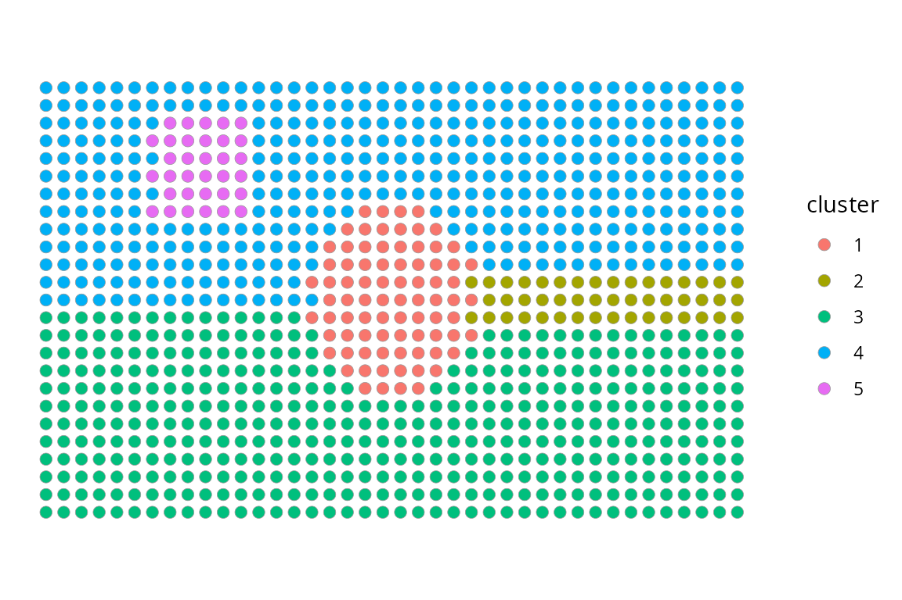
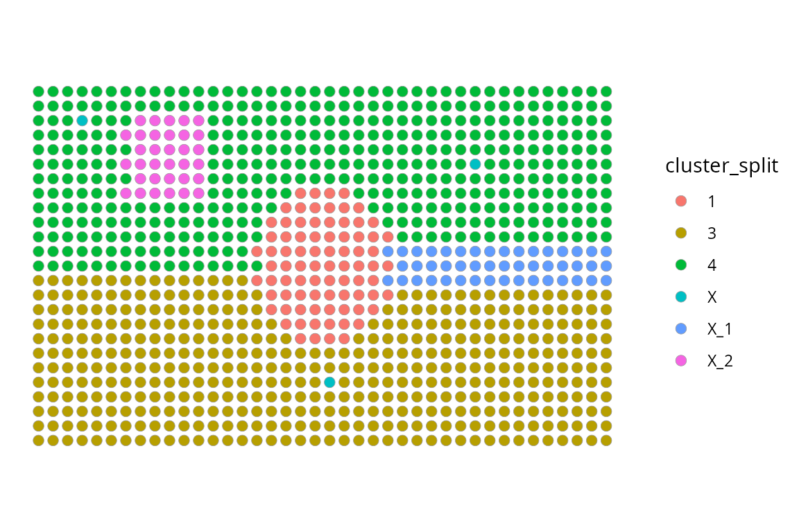
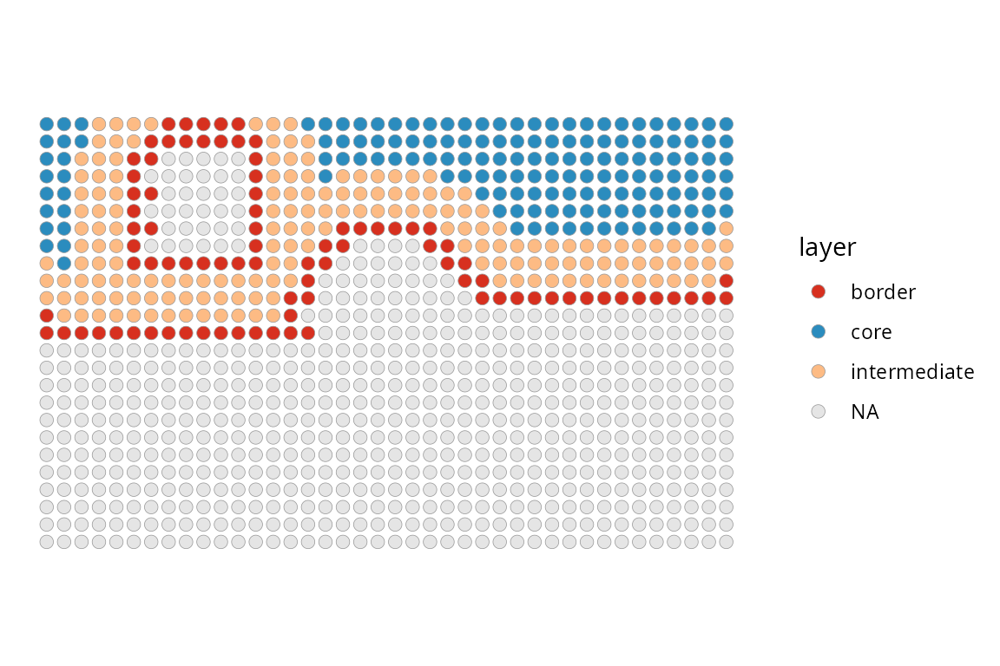
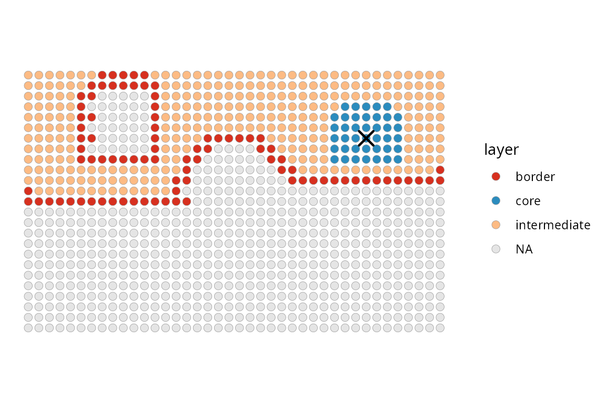
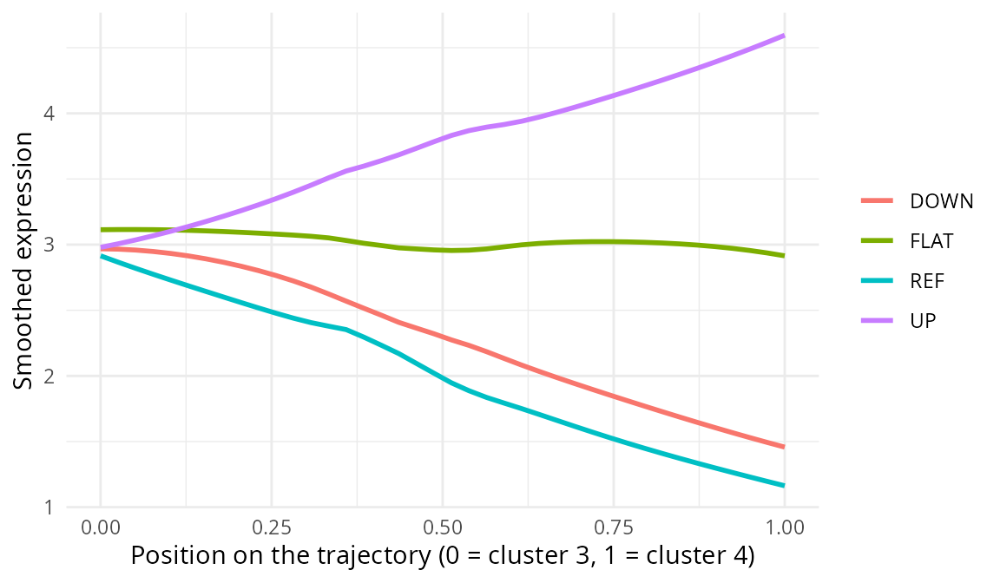

# What's new in Battlefield 1.3

This article walks through the functions added or changed in Battlefield
1.3 (Bioconductor devel). All examples use the simulated data shipped
with the package, so they can be run as they are.

- [Splitting a scattered cluster](#split):
  [`split_clusters()`](https://zhefrench.github.io/Battlefield/reference/split_clusters.md),
  [`add_split_to_spe()`](https://zhefrench.github.io/Battlefield/reference/add_split_to_spe.md),
  [`clean_orphans()`](https://zhefrench.github.io/Battlefield/reference/clean_orphans.md)
- [Layers where core and border never touch](#layers):
  [`create_cluster_layers()`](https://zhefrench.github.io/Battlefield/reference/create_cluster_layers.md)
  with `center` and `core_radius`
- [Picking spots interactively](#viewer):
  [`view_spots()`](https://zhefrench.github.io/Battlefield/reference/view_spots.md)
- [Neighbourhood of a spot given by its coordinates](#neighbourhood):
  [`get_neighborhood_spots()`](https://zhefrench.github.io/Battlefield/reference/get_neighborhood_spots.md)
- [Gene trends along a trajectory](#trends):
  [`compare_gene_trends()`](https://zhefrench.github.io/Battlefield/reference/compare_gene_trends.md)

\
[`library`](https://rdrr.io/r/base/library.html)`(`[`Battlefield`](https://github.com/ZheFrench/BattleField)`)`\
[`library`](https://rdrr.io/r/base/library.html)`(`[`SpatialExperiment`](https://github.com/drighelli/SpatialExperiment)`)`\
[`library`](https://rdrr.io/r/base/library.html)`(`[`ggplot2`](https://ggplot2.tidyverse.org)`)`

We use the simulated Visium HD 16 µm slide, and keep its coordinates and
cluster labels in a data frame, as in the main vignette.

\
[`data`](https://rdrr.io/r/utils/data.html)`(``"visiumHD_16um_simulated_spe"``, package ``=`` ``"Battlefield"``)`\
`spe`` ``<-`` ``visiumHD_16um_simulated_spe`\
`df`` ``<-`` `[`data.frame`](https://rdrr.io/r/base/data.frame.html)`(`\
`  spot_id ``=`` `[`colnames`](https://rdrr.io/r/base/colnames.html)`(``spe``)``,`\
`  x ``=`` `[`spatialCoords`](https://rdrr.io/pkg/SpatialExperiment/man/SpatialExperiment-methods.html)`(``spe``)``[``, ``1``]``,`\
`  y ``=`` `[`spatialCoords`](https://rdrr.io/pkg/SpatialExperiment/man/SpatialExperiment-methods.html)`(``spe``)``[``, ``2``]``,`\
`  cluster ``=`` `[`as.character`](https://rdrr.io/r/base/character.html)`(``spe``$``cluster``)`\
`)`

A small helper draws spots coloured by any column:

\
`plot_spots`` ``<-`` ``function``(``d``, ``col``, ``palette`` ``=`` ``NULL``)`` ``{`\
`  ``p`` ``<-`` `[`ggplot`](https://ggplot2.tidyverse.org/reference/ggplot.html)`(``d``, `[`aes`](https://ggplot2.tidyverse.org/reference/aes.html)`(``x``, ``y``, fill ``=`` ``.data``[[``col``]``]``)``)`` ``+`\
`    `[`geom_point`](https://ggplot2.tidyverse.org/reference/geom_point.html)`(``shape ``=`` ``21``, size ``=`` ``2.6``, colour ``=`` ``"grey60"``, stroke ``=`` ``0.2``)`` ``+`\
`    `[`coord_equal`](https://ggplot2.tidyverse.org/reference/coord_fixed.html)`(``)`` ``+`\
`    `[`theme_minimal`](https://ggplot2.tidyverse.org/reference/ggtheme.html)`(``)`` ``+`\
`    `[`labs`](https://ggplot2.tidyverse.org/reference/labs.html)`(``x ``=`` ``NULL``, y ``=`` ``NULL``, fill ``=`` ``col``)`` ``+`\
`    `[`theme`](https://ggplot2.tidyverse.org/reference/theme.html)`(``axis.text ``=`` `[`element_blank`](https://ggplot2.tidyverse.org/reference/element.html)`(``)``, panel.grid ``=`` `[`element_blank`](https://ggplot2.tidyverse.org/reference/element.html)`(``)``)`\
`  ``if`` ``(``!`[`is.null`](https://rdrr.io/r/base/NULL.html)`(``palette``)``)`` ``p`` ``<-`` ``p`` ``+`` `[`scale_fill_manual`](https://ggplot2.tidyverse.org/reference/scale_manual.html)`(``values ``=`` ``palette``,`\
`                                                    na.value ``=`` ``"grey90"``)`\
`  ``p`\
`}`\
`plot_spots``(``df``, ``"cluster"``)`

## Splitting a scattered cluster

A clustering method can give the same label to regions that are far
apart. Layers, borders or trajectories computed on such a cluster then
mix several regions. To mimic this, we merge clusters 2 and 5, which do
not touch, into a single cluster `X`, and add three isolated `X` spots
inside cluster 4.

\
`df_x`` ``<-`` ``df`\
`df_x``$``cluster``[``df_x``$``cluster`` `[`%in%`](https://rdrr.io/r/base/match.html)` `[`c`](https://rdrr.io/r/base/c.html)`(``"2"``, ``"5"``)``]`` ``<-`` ``"X"`\
`orphans`` ``<-`` `[`c`](https://rdrr.io/r/base/c.html)`(`[`closest_spot`](https://zhefrench.github.io/Battlefield/reference/closest_spot.md)`(``df_x``, ``12000``, ``7600``)``$``spot_id``,`\
`             `[`closest_spot`](https://zhefrench.github.io/Battlefield/reference/closest_spot.md)`(``df_x``, ``1200``, ``8800``)``$``spot_id``,`\
`             `[`closest_spot`](https://zhefrench.github.io/Battlefield/reference/closest_spot.md)`(``df_x``, ``8000``, ``1600``)``$``spot_id``)`\
`df_x``$``cluster``[``df_x``$``spot_id`` `[`%in%`](https://rdrr.io/r/base/match.html)` ``orphans``]`` ``<-`` ``"X"`\
[`table`](https://rdrr.io/r/base/table.html)`(``df_x``$``cluster``)`\
`#> `\
`#>   1   3   4   X `\
`#>  81 427 409  83`

[`split_clusters()`](https://zhefrench.github.io/Battlefield/reference/split_clusters.md)
finds the contiguous pieces of one cluster. Pieces of at least
`min_size` spots are renamed `X_1`, `X_2`, … from largest to smallest;
smaller pieces (the orphans) keep the label `X`.

\
`split`` ``<-`` `[`split_clusters`](https://zhefrench.github.io/Battlefield/reference/split_clusters.md)`(``df_x``, ``"X"``, min_size ``=`` ``5``)`\
[`table`](https://rdrr.io/r/base/table.html)`(``split``$``cluster_split``)`\
`#> `\
`#>   1   3   4   X X_1 X_2 `\
`#>  81 427 409   3  47  33`\
`plot_spots``(``split``, ``"cluster_split"``)`

To split several clusters, call it again with
`cluster_col = "cluster_split"`.
[`add_split_to_spe()`](https://zhefrench.github.io/Battlefield/reference/add_split_to_spe.md)
stores the labels in the colData, matched by `spot_id`, without changing
the original cluster column:

\
`spe_x`` ``<-`` ``spe`\
`spe_x``$``cluster`` ``<-`` ``df_x``$``cluster`\
`spe_x`` ``<-`` `[`add_split_to_spe`](https://zhefrench.github.io/Battlefield/reference/add_split_to_spe.md)`(``spe_x``, ``split``)`\
[`table`](https://rdrr.io/r/base/table.html)`(``spe_x``$``cluster``, ``spe_x``$``cluster_split``)`\
`#>    `\
`#>       1   3   4   X X_1 X_2`\
`#>   1  81   0   0   0   0   0`\
`#>   3   0 427   0   0   0   0`\
`#>   4   0   0 409   0   0   0`\
`#>   X   0   0   0   3  47  33`

[`clean_orphans()`](https://zhefrench.github.io/Battlefield/reference/clean_orphans.md)
removes the pieces of a cluster smaller than `min_size`. Spots of other
clusters are always kept.

\
`cleaned`` ``<-`` `[`clean_orphans`](https://zhefrench.github.io/Battlefield/reference/clean_orphans.md)`(``df_x``, ``"X"``, min_size ``=`` ``5``)`\
[`setdiff`](https://generics.r-lib.org/reference/setops.html)`(``df_x``$``spot_id``, ``cleaned``$``spot_id``)`\
`#> [1] "bin16_884" "bin16_181" "bin16_791"`

To clean layers, compute them with all spots first, then remove the
orphans from the result, so that the orphans still count as neighbours
when layers are defined:

\
`layers_x`` ``<-`` `[`create_cluster_layers`](https://zhefrench.github.io/Battlefield/reference/create_cluster_layers.md)`(``df_x``, ``"X"``, k ``=`` ``8``)`\
`layers_x`` ``<-`` `[`clean_orphans`](https://zhefrench.github.io/Battlefield/reference/clean_orphans.md)`(``layers_x``, ``"X"``, min_size ``=`` ``5``)`\
[`table`](https://rdrr.io/r/base/table.html)`(``layers_x``$``layer``)`\
`#> `\
`#>       border         core intermediate `\
`#>           55            2           23`

## Layers where core and border never touch

[`create_cluster_layers()`](https://zhefrench.github.io/Battlefield/reference/create_cluster_layers.md)
classifies the spots of a cluster into border, intermediate and core.
Since 1.3, every spot touching a border spot is intermediate, so core
and border are never in contact. A narrow cluster can therefore have no
core at all.

\
`layer_cols`` ``<-`` `[`c`](https://rdrr.io/r/base/c.html)`(``border ``=`` ``"#d7301f"``, intermediate ``=`` ``"#fdbb84"``,`\
`                core ``=`` ``"#2b8cbe"``)`\
`layers`` ``<-`` `[`create_cluster_layers`](https://zhefrench.github.io/Battlefield/reference/create_cluster_layers.md)`(``df``, target_cluster ``=`` ``"4"``, k ``=`` ``8``)`\
[`table`](https://rdrr.io/r/base/table.html)`(``layers``$``layer``)`\
`#> `\
`#>       border         core intermediate `\
`#>           88          151          172`\
`plot_spots``(`[`merge`](https://rdrr.io/r/base/merge.html)`(``df``, ``layers``[``, `[`c`](https://rdrr.io/r/base/c.html)`(``"spot_id"``, ``"layer"``)``]``, all.x ``=`` ``TRUE``)``,`\
`           ``"layer"``, ``layer_cols``)`

The new `center` argument places the core around a chosen spot, given by
its identifier or by its coordinates. Border spots are unchanged; core
spots are the non-border spots closest to `center`, either within
`core_radius` (in coordinate units) or, by default, the closest
`1 - intermediate_quantile` share.

\
`core`` ``<-`` ``layers``[``layers``$``layer`` ``==`` ``"core"``, ``]`\
`center`` ``<-`` `[`closest_spot`](https://zhefrench.github.io/Battlefield/reference/closest_spot.md)`(``core``, ``12800``, ``7200``)``$``spot_id`\
`layers_c`` ``<-`` `[`create_cluster_layers`](https://zhefrench.github.io/Battlefield/reference/create_cluster_layers.md)`(``df``, target_cluster ``=`` ``"4"``, k ``=`` ``8``,`\
`                                  center ``=`` ``center``, core_radius ``=`` ``1500``)`\
[`table`](https://rdrr.io/r/base/table.html)`(``layers_c``$``layer``)`\
`#> `\
`#>       border         core intermediate `\
`#>           88           40          283`\
`plot_spots``(`[`merge`](https://rdrr.io/r/base/merge.html)`(``df``, ``layers_c``[``, `[`c`](https://rdrr.io/r/base/c.html)`(``"spot_id"``, ``"layer"``)``]``, all.x ``=`` ``TRUE``)``,`\
`           ``"layer"``, ``layer_cols``)`` ``+`\
`  `[`geom_point`](https://ggplot2.tidyverse.org/reference/geom_point.html)`(``data ``=`` ``df``[``df``$``spot_id`` ``==`` ``center``, ``]``, shape ``=`` ``4``, size ``=`` ``4``,`\
`             stroke ``=`` ``1.2``, inherit.aes ``=`` ``FALSE``, `[`aes`](https://ggplot2.tidyverse.org/reference/aes.html)`(``x``, ``y``)``)`

## Picking spots interactively

[`view_spots()`](https://zhefrench.github.io/Battlefield/reference/view_spots.md)
draws the spots on an interactive plotly map, over the slide image when
the object holds one (the simulated data have none). Hover a spot to see
its identifier and coordinates; click spots, or use the box and lasso
tools, to select them. A panel then gives the R code to copy: a `spots`
vector and, for one or two spots, data frames `A` and `B` ready for
[`build_one_trajectory()`](https://zhefrench.github.io/Battlefield/reference/build_one_trajectory.md)
or
[`build_similar_trajectories()`](https://zhefrench.github.io/Battlefield/reference/build_similar_trajectories.md).

Try it below: the map is live.

\
[`view_spots`](https://zhefrench.github.io/Battlefield/reference/view_spots.md)`(``spe``, color_by ``=`` ``"cluster"``)`

With a real Visium object, `image_file` and `scale_factor` let you use
another image than the stored one, and `file` writes the viewer to a
self-contained HTML page that can be shared.

## Neighbourhood of a spot given by its coordinates

[`get_neighborhood_spots()`](https://zhefrench.github.io/Battlefield/reference/get_neighborhood_spots.md)
and
[`count_neighborhood()`](https://zhefrench.github.io/Battlefield/reference/count_neighborhood.md)
now accept, as `spot_id`, a one-row data frame with the exact
coordinates of a spot, such as `A` copied from
[`view_spots()`](https://zhefrench.github.io/Battlefield/reference/view_spots.md).
Passing several spots is now an error.

\
`A`` ``<-`` `[`data.frame`](https://rdrr.io/r/base/data.frame.html)`(``x ``=`` ``4000``, y ``=`` ``4400``)``   ``# a spot at the 3 / 4 interface`\
`nb`` ``<-`` `[`get_neighborhood_spots`](https://zhefrench.github.io/Battlefield/reference/get_neighborhood_spots.md)`(``df``, spot_id ``=`` ``A``, k ``=`` ``24``)`\
[`table`](https://rdrr.io/r/base/table.html)`(``nb``$``neighborhood``)`\
`#> `\
`#>  3  4 `\
`#> 14 10`

## Gene trends along a trajectory

[`compare_gene_trends()`](https://zhefrench.github.io/Battlefield/reference/compare_gene_trends.md)
tests whether genes decrease or increase along trajectories built with
[`build_similar_trajectories()`](https://zhefrench.github.io/Battlefield/reference/build_similar_trajectories.md)
and stored by
[`add_trajectories_to_spe()`](https://zhefrench.github.io/Battlefield/reference/add_trajectories_to_spe.md).
The spots are fixed; only the genes change.

For each gene, the slope (change in expression from the start to the end
of the trajectory) comes from a generalized least squares model whose
residuals can be spatially correlated, so neighbouring spots are not
counted as independent observations. P-values are one-sided, adjusted by
Benjamini-Hochberg, and `r_curve` measures how similar each smoothed
profile is to that of a reference gene.

We first build parallel trajectories from the centre of cluster 3 to the
centre of cluster 4:

\
`centroids`` ``<-`` `[`compute_centroids`](https://zhefrench.github.io/Battlefield/reference/compute_centroids.md)`(``df``)`\
`A`` ``<-`` ``centroids``[``centroids``$``cluster`` ``==`` ``3``, `[`c`](https://rdrr.io/r/base/c.html)`(``"x"``, ``"y"``)``]`\
`B`` ``<-`` ``centroids``[``centroids``$``cluster`` ``==`` ``4``, `[`c`](https://rdrr.io/r/base/c.html)`(``"x"``, ``"y"``)``]`\
`trajs`` ``<-`` `[`build_similar_trajectories`](https://zhefrench.github.io/Battlefield/reference/build_similar_trajectories.md)`(``df``, ``A``, ``B``, top_n ``=`` ``12``, n_extra ``=`` ``2``,`\
`                                    side ``=`` ``"both"``)`\
[`length`](https://rdrr.io/r/base/length.html)`(`[`unique`](https://rdrr.io/r/base/unique.html)`(``trajs``$``trajectory_id``)``)`\
`#> [1] 5`

The simulated slide holds a single gene, so we simulate a reference gene
and three genes that decrease, increase or stay flat along the
trajectory:

\
[`set.seed`](https://rdrr.io/r/base/Random.html)`(``1``)`\
`pos`` ``<-`` `[`rep`](https://rdrr.io/r/base/rep.html)`(``0.5``, `[`nrow`](https://rdrr.io/r/base/nrow.html)`(``df``)``)`\
`pos``[`[`match`](https://rdrr.io/r/base/match.html)`(``trajs``$``spot_id``, ``df``$``spot_id``)``]`` ``<-`` ``trajs``$``pos_on_seg`\
`sim`` ``<-`` ``function``(``slope``)`` ``3`` ``+`` ``slope`` ``*`` ``pos`` ``+`` `[`rnorm`](https://rdrr.io/r/stats/Normal.html)`(`[`length`](https://rdrr.io/r/base/length.html)`(``pos``)``, sd ``=`` ``0.3``)`\
`logcounts`` ``<-`` `[`rbind`](https://rdrr.io/r/base/cbind.html)`(``REF ``=`` ``sim``(``-``2``)``, DOWN ``=`` ``sim``(``-``1.5``)``, UP ``=`` ``sim``(``1.5``)``,`\
`                   FLAT ``=`` ``sim``(``0``)``)`\
[`colnames`](https://rdrr.io/r/base/colnames.html)`(``logcounts``)`` ``<-`` ``df``$``spot_id`\
`toy`` ``<-`` `[`SpatialExperiment`](https://rdrr.io/pkg/SpatialExperiment/man/SpatialExperiment.html)`(`\
`  assays ``=`` `[`list`](https://rdrr.io/r/base/list.html)`(``logcounts ``=`` ``logcounts``)``,`\
`  spatialCoords ``=`` `[`as.matrix`](https://rdrr.io/r/base/matrix.html)`(``df``[``, `[`c`](https://rdrr.io/r/base/c.html)`(``"x"``, ``"y"``)``]``)`\
`)`\
`toy`` ``<-`` `[`add_trajectories_to_spe`](https://zhefrench.github.io/Battlefield/reference/add_trajectories_to_spe.md)`(``toy``, trajectory ``=`` ``trajs``)`

\
`res`` ``<-`` `[`compare_gene_trends`](https://zhefrench.github.io/Battlefield/reference/compare_gene_trends.md)`(``toy``, genes ``=`` `[`c`](https://rdrr.io/r/base/c.html)`(``"DOWN"``, ``"UP"``, ``"FLAT"``)``,`\
`                           reference ``=`` ``"REF"``)`\
`res`\
`#>   gene      slope    r_curve     fdr_down       fdr_up   trend    status`\
`#> 1  REF -1.8237565  1.0000000           NA           NA     ref reference`\
`#> 2 DOWN -1.6949907  0.9960631 3.499210e-13 1.000000e+00     dec    tested`\
`#> 3 FLAT -0.1801978  0.8093483 1.212369e-01 1.000000e+00 unknown    tested`\
`#> 4   UP  1.6096922 -0.9953335 1.000000e+00 1.261951e-15     inc    tested`

The smoothed profiles, pooled over all lines, are returned in
`attr(res, "curves")`:

\
[`ggplot`](https://ggplot2.tidyverse.org/reference/ggplot.html)`(`[`attr`](https://rdrr.io/r/base/attr.html)`(``res``, ``"curves"``)``, `[`aes`](https://ggplot2.tidyverse.org/reference/aes.html)`(``position``, ``mean``, colour ``=`` ``gene``)``)`` ``+`\
`  `[`geom_line`](https://ggplot2.tidyverse.org/reference/geom_path.html)`(``linewidth ``=`` ``1``)`` ``+`\
`  `[`theme_minimal`](https://ggplot2.tidyverse.org/reference/ggtheme.html)`(``)`` ``+`\
`  `[`labs`](https://ggplot2.tidyverse.org/reference/labs.html)`(``x ``=`` ``"Position on the trajectory (0 = cluster 3, 1 = cluster 4)"``,`\
`       y ``=`` ``"Smoothed expression"``, colour ``=`` ``NULL``)`

A spatial pattern about as long as the trajectory cannot be told apart
from a trend, so the FDR stay optimistic in that case: use them to rank
genes within a sample, and replicate across samples to conclude. Do not
use the gene that guided the choice of trajectory as evidence.

## Session info

\
[`sessionInfo`](https://rdrr.io/r/utils/sessionInfo.html)`(``)`\
`#> R version 4.6.1 (2026-06-24)`\
`#> Platform: x86_64-conda-linux-gnu`\
`#> Running under: Ubuntu 24.04.5 LTS`\
`#> `\
`#> Matrix products: default`\
`#> BLAS/LAPACK: /home/jp/anaconda3/envs/bioc-devel/lib/libopenblasp-r0.3.34.so;  LAPACK version 3.12.0`\
`#> `\
`#> locale:`\
`#>  [1] LC_CTYPE=en_US.UTF-8       LC_NUMERIC=C              `\
`#>  [3] LC_TIME=fr_FR.UTF-8        LC_COLLATE=en_US.UTF-8    `\
`#>  [5] LC_MONETARY=fr_FR.UTF-8    LC_MESSAGES=en_US.UTF-8   `\
`#>  [7] LC_PAPER=fr_FR.UTF-8       LC_NAME=C                 `\
`#>  [9] LC_ADDRESS=C               LC_TELEPHONE=C            `\
`#> [11] LC_MEASUREMENT=fr_FR.UTF-8 LC_IDENTIFICATION=C       `\
`#> `\
`#> time zone: Europe/Paris`\
`#> tzcode source: system (glibc)`\
`#> `\
`#> attached base packages:`\
`#> [1] stats4    stats     graphics  grDevices utils     datasets  methods  `\
`#> [8] base     `\
`#> `\
`#> other attached packages:`\
`#>  [1] ggplot2_4.0.4               SpatialExperiment_1.23.0   `\
`#>  [3] SingleCellExperiment_1.35.2 SummarizedExperiment_1.43.0`\
`#>  [5] Biobase_2.73.2              GenomicRanges_1.65.4       `\
`#>  [7] Seqinfo_1.3.2               IRanges_2.47.5             `\
`#>  [9] S4Vectors_0.51.10           BiocGenerics_0.59.13       `\
`#> [11] generics_0.1.4              MatrixGenerics_1.25.0      `\
`#> [13] matrixStats_1.5.0           Battlefield_1.3.1          `\
`#> `\
`#> loaded via a namespace (and not attached):`\
`#>  [1] gtable_0.3.6        rjson_0.2.23        xfun_0.62          `\
`#>  [4] bslib_0.12.0        htmlwidgets_1.6.4   lattice_0.23-1     `\
`#>  [7] crosstalk_1.2.2     vctrs_0.7.3         tools_4.6.1        `\
`#> [10] tibble_3.3.1        pkgconfig_2.0.3     Matrix_1.7-6       `\
`#> [13] data.table_1.18.6.1 RColorBrewer_1.1-3  S7_1.0.0           `\
`#> [16] desc_1.4.3          lifecycle_1.0.5     compiler_4.6.1     `\
`#> [19] farver_2.1.2        textshaping_1.1.0   htmltools_0.5.9    `\
`#> [22] sass_0.5.0          yaml_2.3.12         plotly_4.12.1      `\
`#> [25] tidyr_1.3.2         pillar_1.11.1       pkgdown_2.2.1      `\
`#> [28] jquerylib_0.1.4     DelayedArray_0.39.8 cachem_1.1.0       `\
`#> [31] magick_2.9.1        abind_1.4-8         tidyselect_1.2.1   `\
`#> [34] digest_0.6.39       purrr_1.2.2         dplyr_1.2.1        `\
`#> [37] labeling_0.4.3      fastmap_1.2.0       grid_4.6.1         `\
`#> [40] cli_3.6.6           SparseArray_1.13.5  magrittr_2.0.5     `\
`#> [43] S4Arrays_1.13.3     dichromat_2.0-1     withr_3.0.3        `\
`#> [46] scales_1.4.0        rmarkdown_2.32      XVector_0.53.0     `\
`#> [49] httr_1.4.9          igraph_2.3.4        otel_0.3.0         `\
`#> [52] RANN_2.6.3          ragg_1.5.2          evaluate_1.0.5     `\
`#> [55] knitr_1.52          viridisLite_0.4.3   rlang_1.3.0        `\
`#> [58] Rcpp_1.1.2          glue_1.8.1          jsonlite_2.0.0     `\
`#> [61] R6_2.6.1            systemfonts_1.3.4   fs_2.1.0`
